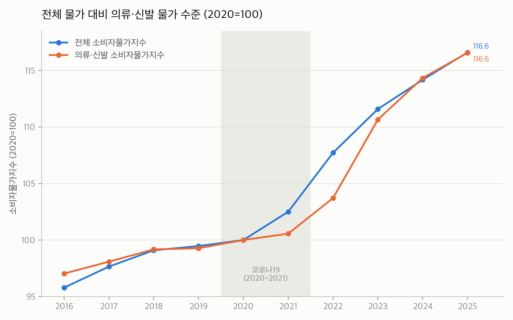
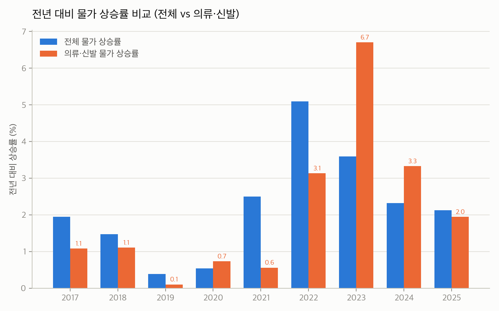
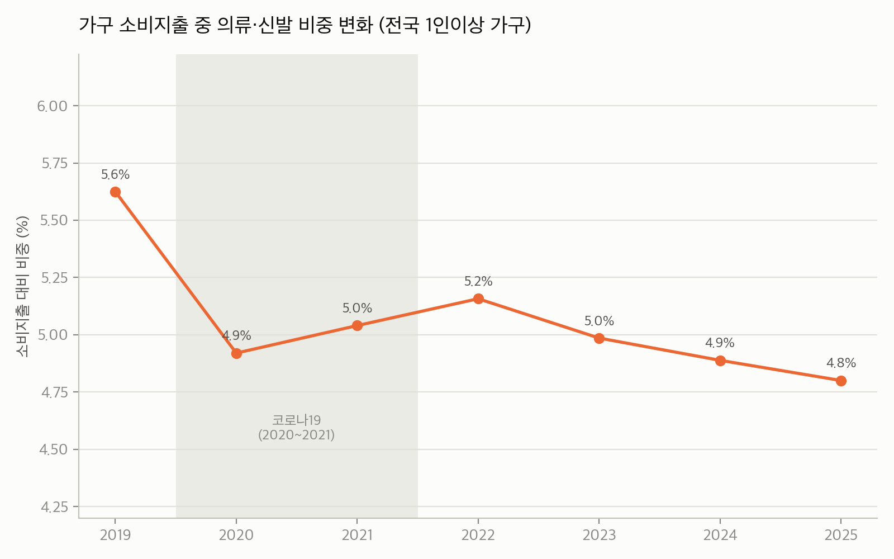

# 의류·신발 물가와 가계 소비 분석 보고서

작성일: 2026-10-16
데이터 출처: KOSIS(국가통계포털) Open API, 공개 뉴스 기사 4건 — 번호는 `references/sources.md`의 [1]~[6] 참조

## 데이터 개요

| 데이터 | 표 ID | 범위 | 단위 | 비고 |
|---|---|---|---|---|
| 전체 소비자물가지수 | DT_1J22001 (지출목적별, 총지수) | 2016~2025, 연간 | 2020=100 | 전국 |
| 의류·신발 소비자물가지수 | DT_1J22001 (지출목적별, 03 의류 및 신발) | 2016~2025, 연간 | 2020=100 | 전국 |
| 가구 월평균 소비지출(전체) | DT_1L9U101 (가계수지항목별, 소비지출) | 2019~2025, 연간 | 원/월 | 전국 1인이상 가구, 명목(경상)금액 |
| 가구 월평균 의류·신발 지출 | DT_1L9U101 (가계수지항목별, 03.의류·신발) | 2019~2025, 연간 | 원/월 | 전국 1인이상 가구, 명목(경상)금액 |

가구지출 통계는 2019년부터 "전국 1인이상 가구" 기준으로 개편되어 그 이전 자료(2인이상 가구 기준, 별도 표)와 직접 연결하지 않았다. 따라서 ②·③의 가계지출 비교는 2019년(코로나 이전 1년)부터만 가능하며, 모두 **명목 금액**이라는 점에 유의해야 한다 — 금액 변화에는 실제 구매량(수량) 변화와 가격(물가) 변화가 섞여 있다.

---

## ① 전체 물가 대비 의류·신발 물가 상승률 비교

- 2016~2025년 누적으로 보면 전체 소비자물가는 +21.7%, 의류·신발 물가는 +20.1% 상승해 **장기적으로는 의류·신발이 전체 물가보다 소폭 덜 올랐다.**
- 다만 연도별 흐름은 반대 방향으로 엇갈린다. 2020~2021년 코로나 시기에는 의류·신발 상승률(각 0.7%, 0.6%)이 전체 물가(0.5%, 2.5%)와 비슷하거나 오히려 완만했지만, **2022~2023년에는 의류·신발이 전체 물가를 추월**했다. 특히 2023년 의류·신발 물가는 전년 대비 **+6.7%** 뛰어 10년 중 가장 큰 폭으로 상승했고, 같은 해 전체 물가 상승률(+3.6%)의 약 두 배에 달했다.
- 2024~2025년에는 전체 물가가 먼저 안정되는 동안(2.3%→2.1%) 의류·신발도 뒤따라 둔화(3.3%→2.0%)됐지만, 2026년 들어 다시 의류·신발 물가가 반등하는 조짐이 뉴스 자료에서 확인된다([3]).

**해석**: 의류·신발은 구조적으로 '저물가' 품목군이 아니라, 원자재(면화)·해상운임·환율 등 공급망 충격에 민감하게 반응하며 특정 시기에 전체 물가를 웃도는 '스파이크형' 품목군이다. 2022~2023년 급등은 팬데믹 이후 글로벌 공급망 재편·원자재 가격 급등과 맞물린다.

---

## ② 가구 소비지출 중 의류 비중 변화

- 가구당 월평균 소비지출에서 의류·신발이 차지하는 비중은 2019년 **5.6%**에서 2025년 **4.8%**로 7년간 약 0.8%p 축소됐다.
- 같은 기간 가구의 전체 소비지출은 명목 기준 +19.6%(2,456,678원→2,939,091원) 늘었지만, 의류·신발 지출은 +2.1%(138,180원→141,084원)에 그쳤다. 물가(①)가 20% 넘게 오른 것을 감안하면, **명목 지출이 물가 상승분조차 따라가지 못했다는 것은 실질 구매량(volume)이 뚜렷하게 줄었다는 의미**다.
- 비중은 2020년 급락(5.6%→4.9%) 이후 2021~2022년 소폭 반등(5.0%→5.2%)했다가 2023년부터 다시 하락세로 돌아서 2025년 4.8%까지 내려왔다. 즉 반등은 일시적 '보복소비'에 가까웠고, 추세 자체는 축소 쪽으로 수렴하고 있다.

---

## ③ 코로나 전후 변화

세 구간(코로나 이전 2019 / 코로나 시기 2020~2021 / 코로나 이후 2022~2025)으로 나눠보면:

| 구간 | 의류·신발 CPI 흐름 | 가구 의류·신발 지출 비중 |
|---|---|---|
| 코로나 이전 (~2019) | 완만한 상승 (연 1%대) | 5.6% (2019) |
| 코로나 시기 (2020~2021) | 상승률 둔화(0.7%, 0.6%) — 물가 자체는 크게 안 떨어짐 | 급락 후 소폭 반등 (4.9%→5.0%) |
| 코로나 이후 (2022~2025) | 급등(최대 +6.7%, 2023) 후 재둔화 | 반등(5.2%, 2022) 후 지속 하락(4.8%, 2025) |

- 코로나 시기에는 '가격'보다 '수요'가 먼저 꺾였다. 외출·행사·출근 감소로 의류 구매 자체가 줄면서 지출액이 급감했지만(2020년 전년 대비 -14.5%), 물가지수는 거의 밀리지 않았다 — 즉 **안 사게 됐을 뿐 안 팔던 제품이 싸지지는 않았다.**
- 반면 2022~2023년은 정반대 패턴이다. 억눌렸던 수요가 풀리며 지출 비중이 잠깐 반등했지만, 동시에 원자재·물류비 급등으로 물가가 가장 가파르게 올랐다. 소비자는 더 쓰고 싶어도 가격 상승 탓에 실질 구매는 제한됐을 가능성이 크다.
- 결과적으로 코로나는 의류 소비에 '일시적 충격'이 아니라 **지출 비중의 구조적 하향 추세를 가속한 계기**로 보인다. 팬데믹 이전부터 이어지던 완만한 비중 축소가, 팬데믹 이후의 고물가 국면과 맞물리며 더 뚜렷해졌다.

---

## ④ 뉴스 자료로 본 원인 해석 — 의류학과 관점(패스트패션/소비 트렌드)

1. **가격 저항의 등장** — 한국섬유신문([3])은 2026년 8월 의류·신발 CPI가 전년比 2.8% 오른 것을 두고 "패션 소비 가격 저항이 커진다"고 짚었다. 이는 ②에서 확인한 비중 축소와 정확히 같은 방향이다. 패스트패션이 오랫동안 의존해온 '저가·대량·빠른 회전' 공식이, 물가가 계속 오르는 상황에서는 더 이상 소비자의 지출 확대로 이어지지 않는다는 뜻이다. 소비자들이 가격 대비 효용을 더 까다롭게 따지기 시작했다는 것은 전형적인 '합리적 소비(스마트 컨슈머)' 전환의 신호다.

2. **원가발 가격 인상의 지속** — 국제섬유신문([4])은 미국의 관세 정책으로 2026년 의류 가격이 5% 이상 오를 것이라는 전망과, 브랜드들이 멕시코·튀르키예 등으로 소싱처를 다변화하는 흐름을 전한다. 이는 ①에서 확인한 2022~2023년 급등이 일회성이 아니라, 관세·물류·환율 변수에 따라 앞으로도 반복될 수 있는 '구조적 리스크'임을 시사한다. 패스트패션 공급망은 저임금·근접 소싱에 의존해온 만큼, 관세·소싱처 재편은 '빠르고 싸게'라는 핵심 경쟁력 자체를 흔드는 요인이다.

3. **경기·기후 변수에 더 취약해진 패션 소비** — 뉴스메이커([5])는 2025년 경기 둔화와 이상기후로 인한 계절성 약화가 패션업계 실적 부진(삼성물산·한섬·LF 등 영업이익 큰 폭 감소)으로 이어졌다고 분석한다. 패스트패션/시즌 중심 소비 모델은 본래 "정해진 계절에, 정해진 신상품을 낸다"는 전제 위에 서 있는데, 이상기후로 그 전제 자체가 흔들리면 재고 부담 증가 → 할인 확대 → 수익성 악화의 악순환이 발생한다. 이는 공급 측에서 패스트패션 모델의 구조적 피로를 보여주는 사례다.

4. **업계의 체질 전환 신호** — 삼성패션연구소([6])는 2025년 키워드로 '보완(BACKFILLED)'을 제시하며, 업계가 과도한 확장보다 효율화·안정 운영에 주목했다고 평가했다. 이는 패스트패션 전성기의 '외형 성장' 전략에서 벗어나, 가격 저항과 수요 둔화에 맞춰 사업 구조를 재조정하는 산업 차원의 대응으로 읽을 수 있다.

**종합 해석(의류학과 관점)**: 데이터와 뉴스를 함께 보면, 지난 10년의 의류·신발 소비는 "싸게 많이 산다"는 전통적 패스트패션 공식에서 "가격을 따져 신중하게 산다"는 방향으로 이동 중이다. 물가(①)는 공급망 충격 때마다 스파이크를 그리는데, 가계 지출 비중(②)은 오히려 추세적으로 줄고 있다는 사실 자체가 이 전환을 수치로 보여준다. 패스트패션 업계가 가격 인상(관세·원가 압박, [4])과 수요 둔화(경기·기후, [5])라는 양방향 압박을 동시에 받으면서, 중고/리세일 플랫폼 확산, 실용성 중심 구매, '적게 사지만 신중하게 사는' 소비 트렌드가 구조적으로 자리 잡고 있다고 해석할 수 있다. 업계의 '효율화' 선언([6])은 이런 소비자 변화에 대한 산업의 응답으로 볼 수 있다.

---

## 한계 및 유의사항

- 가구지출 수치는 **명목 금액**으로, 물가 상승분이 그대로 포함돼 있다. 실질(수량) 변화를 더 정확히 보려면 KOSIS의 실질 가계수지 표(예: DT_1L9U118)로 교차 검증이 필요하다.
- 가구지출 시계열은 2019년 이후로 한정된다(1인이상 가구 기준 개편). 2019년 이전과 비교하려면 2인이상 가구 기준의 별도 표(DT_1L9N002 등)를 써야 하며, 가구 정의가 달라 단순 연결은 피했다.
- 뉴스 자료는 4건으로 표본이 제한적이며, 최근 1년 내외(2025.12~2026.09) 보도에 집중돼 있어 추세의 '최신 스냅숏' 성격이 강하다.

## 원자료 / 산출 코드
- 원자료: `data/kosis/cpi_clothing_footwear_2016_2025.csv`, `data/kosis/household_expenditure_clothing_footwear_2019_2025.csv`, `data/news/fashion_price_news_2025_2026.csv`
- 차트: `analysis/charts/01_cpi_total_vs_clothing_2016_2025.png`, `analysis/charts/02_cpi_yoy_growth_2017_2025.png`, `analysis/charts/03_clothing_share_of_consumption_2019_2025.png` (matplotlib로 생성)
